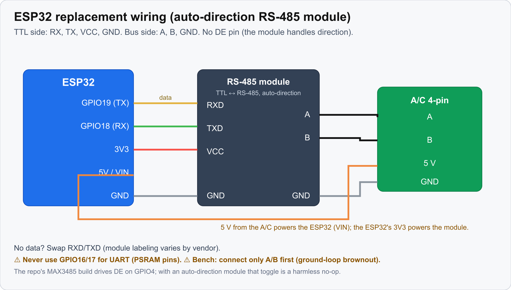
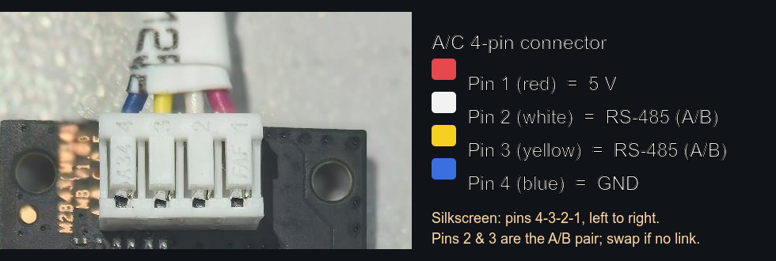

# ESP32 Replacement Board

The recommended hardware: an **ESP32 and an RS-485 transceiver** that take the place of the
AEH-W41H1 module on the A/C's 4-pin connector and run the [ESPHome firmware](ESPHome-Build). This
page is the hardware side: parts, wiring for both boards, the pins to avoid and the staged
bring-up. Code-level notes are in `firmware/docs/16-esp32-board-notes.md`.

← back to [Home](Home) · siblings: [ESPHome Build](ESPHome-Build) ·
[Hardware & Wiring](Hardware-and-Wiring) · [Build, Flash & Test](Build-Flash-Test)

---

## Why replace the module

The W41H1 (RTL8710C) modules **die easily** (ESD and handling, a dead module is a common
failure) and are **hard to source in the EU**. The protocol is the hard part, and it is done and
validated. An ESP32 that speaks the same bus bytes **is** a W41H1 to the mainboard: there is no
Hisense authentication on the wire, only the RS-485 handshake the firmware performs. An ESP32 is
also flashed and recovered over USB, where the stock module needs a clip on its flash chip.

```
Hisense mainboard ──RS-485(A/B)── RS-485 transceiver ──UART── ESP32 ── Wi-Fi ── Home Assistant
```

## BOM (~€5) + wiring

- **ESP32-C3 SuperMini** (small enough to sit where the W41H1 did), 5 V on its `5V` pin. A
  classic ESP32 dev board works too, 5 V on VIN.
- A **3.3 V RS-485 transceiver**: **MAX3485 / SP3485 / SN65HVD75**, with DE+RE tied to a GPIO.
  An **auto-direction** TTL↔RS-485 module also works (the DE toggle is then a harmless no-op).
  **Avoid a 5 V MAX485 module**: its RO would push 5 V into the ESP32 RX and kill it.
- Power and bus come from the A/C's module connector (**5 V confirmed**).

The pins are set per board file in `firmware/esphome/` (or by `dev.py --board`), so there is
nothing to edit when you switch boards:

| Signal | ESP32-C3 SuperMini | classic ESP32-D0WDQ6 | transceiver |
|---|---|---|---|
| TX | GPIO5 → | GPIO19 → | DI (auto-direction module: RXD) |
| RX | GPIO6 ← | GPIO18 ← | RO (auto-direction module: TXD) |
| DE | GPIO10 → | GPIO4 → | DE+RE tied (auto-direction module: not connected) |
| 3V3 / GND | 3V3 / GND | 3V3 / GND | VCC / GND |

Both pin sets run on a live A/C. The C3 set is three consecutive plain GPIOs on one header row:
no strapping pin (2 / 8 / 9), no USB (18 / 19), no UART0 (20 / 21).

**Bus side (transceiver ↔ A/C 4-pin):**

| RS-485 module | | A/C 4-pin |
|---|---|---|
| A | → | RS-485 A |
| B | → | RS-485 B |
| GND | → | GND |
| ESP32 5V / VIN | ← | 5 V |



*Classic ESP32 ↔ auto-direction RS-485 module ↔ A/C 4-pin bus. No data? Swap RXD/TXD (vendor
labeling varies). Never use GPIO16/17 (PSRAM pins).*

The A/C connector pinout:



## The hard-won gotchas

- **⚠️ C3: never put the UART on GPIO18/19.** On the C3 those are the USB D-/D+ lines, and on the
  SuperMini that USB port is the only way to flash it or see its console.
- **⚠️ C3: fit a ~10k pulldown on DE (GPIO10).** DE floats from power-on until the firmware
  configures the pin, and a DE that drifts high parks a second driver on the A/C's bus. It shows up
  as intermittent bus corruption, not as an obvious wiring fault. If firmware and wiring disagree
  on the DE pin, the node sends and never hears a reply: `AC bus link` stays off.
- **⚠️ Brand-new board: erase flash before the first flash** (`dev.py erase esphome --port P`, or
  `esptool.py erase_flash`). A vendor test image can leave a Wi-Fi config in NVS. Never erase a
  board that is already running: that throws away its Wi-Fi settings.
- **⚠️ Never use GPIO16/17 for UART on a WROVER/D0WDQ6 module**: they're bonded to the PSRAM
  die and dead as I/O *even with SPIRAM disabled*. TX-on-17 cost a whole "RX=0 but internal
  loopback passes" debugging session (internal loopback bypasses the pads). Bench tip: prove the
  pins with a bare GPIO19→GPIO18 jumper (RX must track TX) *before* wiring the transceiver.
- **⚠️ Ground loop / brownout**: while the ESP32 is USB-powered (bring-up stage 2), connect
  **only A/B** to the A/C. Routing the mains-earthed A/C GND to the laptop-earthed ESP32 browns
  it out (RTCWDT resets, flash-read errors). A/C GND/5V only join at stage 3 (powered from the
  connector, no laptop).

The history behind these (why the C3's DE moved from GPIO7 to GPIO10, DE-release timing, the
stale-NVS diagnosis) is in `firmware/docs/16-esp32-board-notes.md`. The envelope device-type bytes
are explained in
[Protocol Overview](Protocol-Overview#the-seqhilo-bytes-are-a-device-type-not-a-session-token).

## Staged bring-up (never leave the A/C in an unknown state)

1. **Bench, no A/C**: run the host tests (`dev.py test esphome`), then flash the board and drive
   it with `virtual_ac.py` on a USB adapter (`dev.py bench esphome`, wiring and passing output in
   [Build, Flash & Test](Build-Flash-Test#bench-stage-no-ac)).
2. **Real bus, USB-powered**: remove the module, tap **A/B only** (ground-loop warning). The
   `AC bus link` sensor turns on and the decoded indoor temperature, mode and compressor
   frequency match the unit. This proves the **read** direction. Then send one command.
3. **Full integration**: power from the connector's 5 V, close it up.

Both directions are **hardware-proven**: the mainboard accepts a non-Hisense module, the link
comes up with the device-type bytes learned from the A/C, and nodes drive A/Cs from Home Assistant
this way.

## Build and flash

[User Guide](User-Guide) for the guided way, [Build Environment](ESP32-Build-Environment) for a
clean machine and every step by hand, [ESPHome Build](ESPHome-Build) for what the firmware gives
you. In short:

```
python3 firmware/scripts/dev.py walk esphome --board c3        # or --board classic
```

## Coming from the ESP32 Matter firmware

A board that runs the retired esp-matter build keeps its wiring and can be moved to ESPHome
without a cable: [Migrating an ESP32 Node from Matter to ESPHome](Migrating-ESP32-Matter-to-ESPHome).
