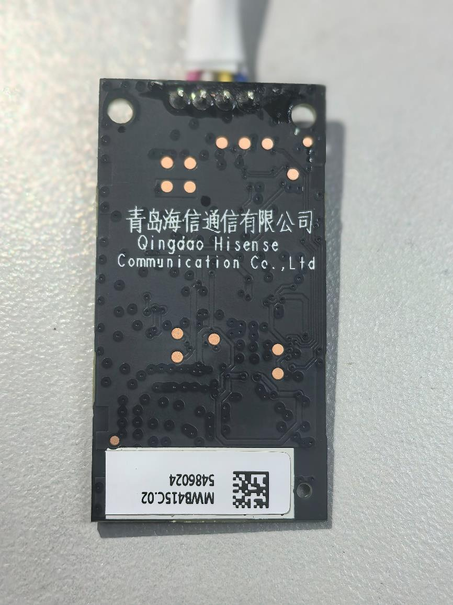

# Hardware and Wiring

What the AEH-W41H1 module is, what is on its board, and the 4-pin port it plugs into. Read this
before you build a replacement board or put a clip on the module.

*The module: a small board in a white housing on a 4-pin cable to the indoor unit. (Photo: FCC ID
2AGCCAEH-W41H1, public record.)*

The module is a sealed plastic dongle. Its connector carries 5 V, GND and an RS-485 A/B pair.
Under an RF shield sit the Wi-Fi chip and its flash. The RS-485 transceiver is outside the shield,
next to the cable connector.

More detail: `reverse-engineering/docs/01-hardware.md` and `reverse-engineering/hardware/pinouts.md`.

## What is on the board

*RF shield removed. 1: the 4-pin A/C connector. 2: the RS-485 transceiver. 3: the SPI flash (the
clip goes here). 4: the RTL8710C. Photo: FCC ID 2AGCCAEH-W41H1, public record.*

| Part | Detail |
|---|---|
| Wi-Fi chip | Realtek RTL8710C (AmebaZ2 family), ARM Cortex-M, Wi-Fi and BLE. Secure boot is off. ESPHome runs on it through the LibreTiny platform ([The Stock Module](Stock-Module-Build)) |
| Flash | GigaDevice GD25Q32(B): 4 MB SPI NOR, SOIC-8, JEDEC ID `C8 40 16`. Two firmware slots, and a settings area near the top |
| RS-485 transceiver | Union Semiconductor UM3352E, MAX485-compatible, SOIC-8 |

*The underside of the board carries the model marking (FCC ID 2AGCCAEH-W41H1, public record).*

## The 4-pin A/C port

The board silkscreens the pins 4-3-2-1 from left to right.

| Pin | Signal | Wire colour on the bench unit |
|---|---|---|
| 1 | 5 V | red |
| 2 | RS-485 A or B | white |
| 3 | RS-485 A or B | yellow |
| 4 | GND | blue |

A and B are interchangeable at wiring time. If the bus does not link, swap them. Wire colours can
differ between revisions, so check them on your own unit before you power anything.

Power comes from the A/C. A bench supply tends to brown out the radio, so run the module, or the
board that replaces it, from the unit.

## The bus

- RS-485, half duplex, 9600 baud, 8N1. The module is the bus master and the A/C mainboard only
  answers ([Protocol Overview](Protocol-Overview#physical-layer)).
- On the module the bus is UART0: TX on `PA_14`, RX on `PA_13`, and the transceiver's driver
  enable (DE) on `PA_17`. The firmware raises DE around every transmission, as the vendor firmware
  does. The module's log console is on `PA_16`.
- On the UM3352E, bus A and B are pins 6 and 7. RO (pin 1) carries the bytes from the A/C at
  logic level, and DI (pin 4) the bytes to the A/C. Both are good points for a sniffer. The logic
  level is probably 5 V, so shift it to 3.3 V before a 3.3 V adapter.

## Access to the flash

The GD25Q32 can be read and written with a CH341A programmer and a SOIC-8 clip. The wiring, the
in-circuit read problem and the CH341A voltage warning are in
[Recovery and Reflash](Recovery-and-Reflash#stock-module-ch341a-clip).

## Next

- To replace the module with an ESP32: [ESP32 Replacement Board](ESP32-Replacement-Build), which
  has the parts, the pin tables and the wiring picture.
- To keep the module: [The Stock Module](Stock-Module-Build), and take a full dump with the clip
  before anything else.
