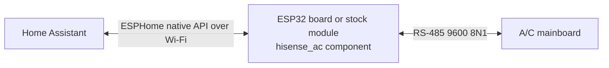

# Hisense AEH-W41H1: local control with ESPHome

Run a Hisense A/C from Home Assistant with no ConnectLife cloud. An ESPHome component speaks the
A/C's internal RS-485 bus and presents the unit as a native climate device. It runs on an ESP32
board that replaces the `AEH-W41H1` Wi-Fi module, or on that module itself.

*The module: a small board in a white housing on a 4-pin cable to the indoor unit. (Photo: FCC ID
2AGCCAEH-W41H1, public record.)*

> Not affiliated with Hisense, Realtek or ESPHome. A bad flash can brick the stock module
> (recoverable from a dump you took first). Do this at your own risk.

Start with the **[User Guide](User-Guide)**: it helps you choose the hardware and names the page
to read next. The pages, in the order a reader needs them:

| Page | What it covers |
|---|---|
| **Start** | |
| [User Guide](User-Guide) | the three kinds of hardware, the state of each, and the route to a working unit |
| [Hardware and Wiring](Hardware-and-Wiring) | the module, its parts, the A/C's 4-pin port, the RS-485 bus |
| [ESP32 Replacement Board](ESP32-Replacement-Build) | parts, wiring for both boards, the pins to avoid, staged bring-up |
| [The Stock Module](Stock-Module-Build) | ESPHome on the original module: state, risks, flash layouts, updates |
| **Build and install** | |
| [Build Environment](ESP32-Build-Environment) | the tools, the secrets file, the first build and flash by hand |
| [Build, Flash and Test](Build-Flash-Test) | the `dev.py` wrapper, and the bench test against the simulator |
| [ESPHome Firmware](ESPHome-Build) | board files, adding the node to Home Assistant, updates, releases, capability gating |
| **Use** | |
| [Everyday Control](Everyday-Control) | the climate entity, special modes, limits, dashboard cards |
| [Entities and Diagnostics](Entities-and-Diagnostics) | every entity, the bus counters, the log lines, confirm and retry |
| [Climate Groups](Climate-Groups) | several A/Cs as one thermostat |
| **When something is wrong** | |
| [Troubleshooting and FAQ](FAQ-Gotchas) | by symptom |
| [Wi-Fi Setup Mode and the Status LED](Wifi-Setup-Mode) | moving a node to another network, the "77" gesture, the LED, safe mode |
| [Recovery and Reflash](Recovery-and-Reflash) | USB recovery for an ESP32, clip recovery for the stock module |
| **Developer** | |
| [Repo Map and Build Pipeline](Repo-Map-and-Build-Pipeline) | where code lives, versions and releases, CI |
| [Testing and QA](Testing-and-QA) | the test layers and their commands |
| [Protocol Overview](Protocol-Overview) | the RS-485 frames in summary |
| **Retired** | |
| [Matter Firmware (Retired)](Matter-Firmware-Retired) | what was retired, the `matter-final` tag, moving a unit to ESPHome |
| [Converting a Stock Module (Moved)](Converting-a-Stock-Module-to-ESPHome) | a pointer to its new place |

The guide is the place to start. `firmware/docs/` and `reverse-engineering/docs/` in the
repository hold the reference behind it: design notes, the byte-level protocol, hardware notes.
Each guide page names the one it draws from.
