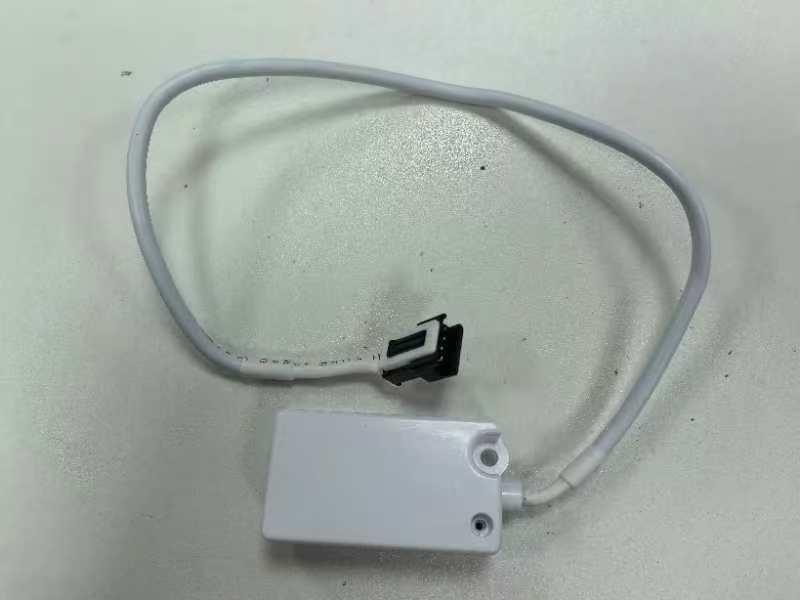

# Hisense AEH-W41H1: local control with ESPHome

Drop the ConnectLife cloud from a Hisense **`AEH-W41H1`** A/C Wi-Fi module and run the A/C from
Home Assistant with no cloud. An ESPHome component speaks the A/C's internal **RS-485** bus
(9600 8N1) and presents the unit as a native climate device. The framing and every byte offset are
hardware-confirmed against a real unit.

*The module: a small board in a white housing on a 4-pin cable to the indoor unit. (Photo: FCC ID
2AGCCAEH-W41H1, public record.)*

> Not affiliated with Hisense, Realtek or ESPHome. A bad flash can brick the stock module
> (recoverable from a dump you took first). Do this at your own risk.

## Status

One firmware, the `hisense_ac` ESPHome component, on three kinds of hardware:

1. **An ESP32 replacement board (recommended):** an ESP32-C3 SuperMini or a classic ESP32 and a
   3.3 V RS-485 transceiver replace the dongle on the same 4-pin bus. On live units since 2026-08.
   See [ESPHome Build](ESPHome-Build) and [ESP32 Replacement Board](ESP32-Replacement-Build).
2. **The stock module itself**, through ESPHome's LibreTiny platform, with nothing added to the
   unit. First run in an A/C on 2026-10-10, and the least proven combination. See
   [ESPHome Build](ESPHome-Build#the-stock-module-without-a-replacement-board).
3. **Other ESPHome chips** (ESP8266, RP2040): the component compiles for them. Nobody has run it
   on one.

One script, `firmware/scripts/dev.py`, checks the tools, tests, builds and flashes: see the
**[User Guide](User-Guide)**.

The project also had two Matter firmwares. They are retired:
[Matter Firmware (Retired)](Matter-Firmware-Retired).

## How it works

## Start here

| Page | What |
|---|---|
| **[User Guide](User-Guide)** | **from a clone to a running node with `dev.py`** |
| [Hardware & Wiring](Hardware-and-Wiring) | the module, SoC/flash/transceiver, the A/C 4-pin port, the RS-485 bus |
| [Build Environment](ESP32-Build-Environment) | from a clean Linux machine to a flashed board: the tools, where they come from, every step by hand |
| [ESPHome Build](ESPHome-Build) | the firmware: entities, boards, flashing, adopting it in Home Assistant, updates |
| [ESP32 Replacement Board](ESP32-Replacement-Build) | parts, wiring for both boards, the GPIO warnings, staged bring-up |
| [Everyday Control](Everyday-Control) | what entities appear, special modes, the dashboard card |
| [Entities and Diagnostics](Entities-and-Diagnostics) | every entity, the beeper, the bus counters, confirm and retry |
| [Climate Groups](Climate-Groups) | several A/Cs as one thermostat with Climate Group Helper |
| [Recovery & Reflash](Recovery-and-Reflash) | USB recovery for an ESP32, CH341A clip recovery for the stock module |
| [FAQ & Gotchas](FAQ-Gotchas) | the load-bearing traps, in Q&A form |

Coming from one of the retired Matter builds:

| Page | What |
|---|---|
| [Matter Firmware (Retired)](Matter-Firmware-Retired) | what was removed, the `matter-final` tag, what was kept |
| [Migrating an ESP32 Node from Matter to ESPHome](Migrating-ESP32-Matter-to-ESPHome) | move an esp-matter board to ESPHome over the air |
| [Converting a Stock Module from Matter to ESPHome](Converting-a-Stock-Module-to-ESPHome) | move a stock module to ESPHome over the air |

## Developer guides

| Page | What |
|---|---|
| **[Build, Flash & Test](Build-Flash-Test)** | **the detail behind the User Guide: `dev.py`, bench testing without an A/C** |
| [Repo Map & Build Pipeline](Repo-Map-and-Build-Pipeline) | where code lives, how it is tested and built, CI |
| [Protocol Overview](Protocol-Overview) | the RS-485 A/C protocol and its framing |
| [Testing & QA](Testing-and-QA) | host tests, the virtual A/C simulator, the hardware checks |

---

This guide is the place to start. The `firmware/docs/` and `reverse-engineering/docs/` files in
the repository hold the deep reference: design rationale, byte-level protocol, hardware notes. Each
page links to the one it draws from.
