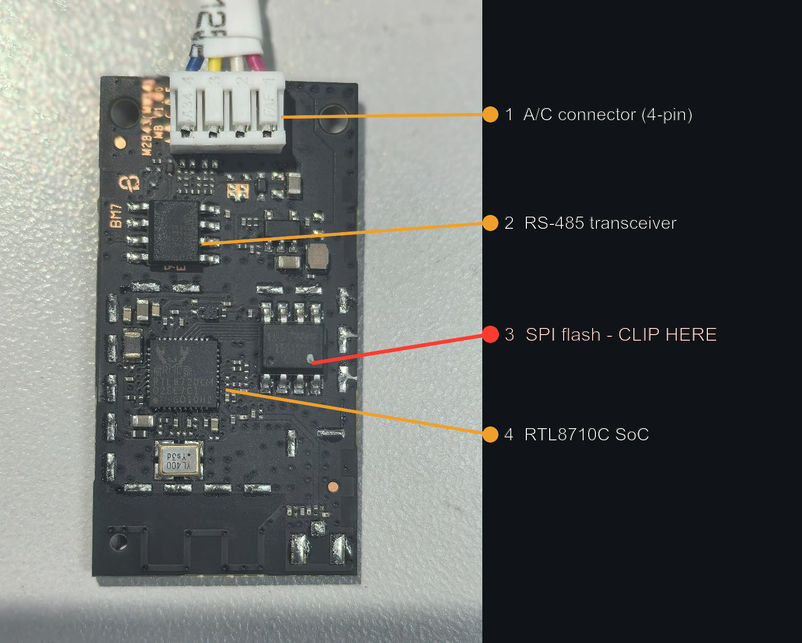
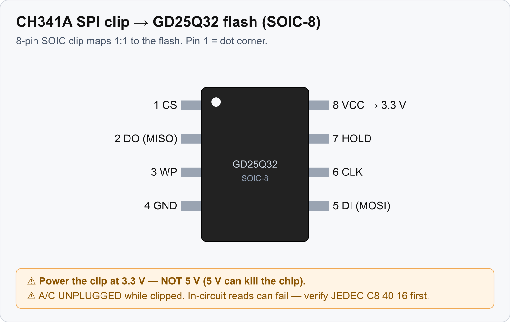

# Recovery and Reflash

How to get a node back when it no longer answers. What works depends on the hardware: an ESP32
board is recovered over its USB port, the stock module with a CH341A programmer and a SOIC-8 clip
on its flash chip. For a first install, start at the [User Guide](User-Guide).

## Try these first

A node that is silent on the network is often not dead.

1. Look for its hotspot. A node that cannot join Wi-Fi opens `<name>-setup` after about a
   minute. Join it and give it the network ([Wi-Fi setup mode](Wifi-Setup-Mode#the-hotspot)).
2. Wait for safe mode. A firmware that crashes at every boot ends up in ESPHome's safe mode
   after ten tries, where it can be updated over the air
   ([safe mode](Wifi-Setup-Mode#safe-mode)).
3. Power-cycle the unit at the mains, and leave a stock module off for 30 seconds
   ([why](Stock-Module-Build#risks)).

## ESP32 boards

An ESP32 cannot be bricked by a bad application image: the ROM bootloader is in silicon, so a USB
write always gets you back. No clip, no dump.

1. Get the board into download mode. Plug it in over USB. If no serial port appears, or the
   write fails to connect, hold the BOOT button while plugging it in (or while pressing RESET),
   then release. On the C3 SuperMini that USB port is the only way in, which is why its GPIO18
   and GPIO19 must never carry the UART.
2. Write the firmware again from source. `secrets.yaml` is compiled in, so the node comes
   back on your Wi-Fi with the same API key, and Home Assistant picks it up without adopting it
   again.

   ```
   python3 firmware/scripts/dev.py flash esphome --board c3 --port /dev/ttyACM0
   ```

   or, from `firmware/esphome/`, `esphome run w41h1-esp32c3.yaml --device /dev/ttyACM0`.

A normal flash leaves the NVS partition alone, so the node keeps a Wi-Fi network it learned
through the setup hotspot. Erasing the whole flash (`esptool.py erase_flash`) wipes NVS. That is right for a
brand-new board with stale vendor settings, and for anything else it means the node goes back to
the Wi-Fi in `secrets.yaml`.

## Stock module (CH341A clip)

If an update leaves a stock module dark, or you want to put back what was on it, write the
GD25Q32 flash chip directly. Read `firmware/docs/10-stock-module-boot-and-recovery.md` first: a
quiet module is often not a dead one, and one read of the flash status register tells the two
apart.

> **Take a dump first.** Before writing anything, read the whole chip and keep the file. It holds
> this unit's calibration data, keys and vendor firmware, and it is the only complete way back.
> Keep it out of git: it also holds your Wi-Fi credentials. The repository ignores `dumps/` for
> that reason.

### Clip it on



*RF shield removed. 3 is the SPI flash. Photo: FCC ID 2AGCCAEH-W41H1, public record.*



*The SOIC-8 clip maps one to one onto the flash pins. Pin 1 is the corner with the dot.*

- Keep the A/C unplugged while the clip is on.
- The common black CH341A drives SPI at about 5 V even in its "3.3 V" mode, which is a hazard for
  a 3.3 V flash chip. Use a board modified for 3.3 V, or a level adapter.
- In-circuit reads and writes can fail because the module's own chip contends for the bus. If you
  read `0xFF` or the programmer finds no device, lift the flash chip or hold the chip in reset.
- The module is fragile. Clip cycles and handling have killed modules by static discharge.

### Use the tools here, not flashrom

Write with the scripts in `firmware/flasher/` (pyusb, with verify and retry per sector). The
common CH341A does silent partial writes with `flashrom` on this chip.
`firmware/flasher/requirements.txt` pins `pyusb`. A stock Linux install needs no udev rule for the
programmer.

| Script | Does |
|---|---|
| `ch341dump.py` | reads the whole chip twice into a file. Do it before every write |
| `ch341_readverify.py` | read-only: spot-checks that the chip matches a full dump |
| `ch341_sr.py` | reads the status registers and says whether the QE bit is set |
| `ch341_setqe.py` | sets the QE bit again |
| `ch341flash-full.py` | writes the whole chip. For putting a unit's own full dump back |
| `ch341flash.py` | writes one firmware slot. **Not run on a module yet** |

The arguments of each tool, what has run on a module, every check that stands before an erase and
what to do after an interrupted write are in
`firmware/flasher/README.md`, which is the reference. In short:

Both writers refuse before the first erase unless all of this holds:

- The chip on the clip answers with the GD25Q32's id.
- The file is what the tool writes. For the whole chip: exactly 4 MB, with a firmware image whose
  signatures all verify, and with the module's system data at `0x1000` (a full-flash image from a
  build has none and is refused). For a slot: an application image that verifies the way the
  bootloader checks it and fits the slot, on a chip whose images sit at the slot addresses of the
  layout you named.
- `--backup` names a full dump made with `ch341dump.py`.
- You type the confirmation it asks for, which names the target and the size, for example
  `chip-0x400000` or `factory-ota2-0x170000`. `--confirm <the same text>` is for a script.

A write that is interrupted, or that stops on a sector that will not verify, leaves the chip half
written with the QE bit clear, and the module does not boot. Run the same command again: sectors
that already hold the image are skipped. None of the tools can tell two modules apart, so whether
a dump belongs to the unit on the clip is for you to know.

### Getting a module back

The way back that has worked on hardware: write the unit's own full dump with
`ch341flash-full.py`, then power-cycle. The unit comes up as it was when the dump was taken. (The
checks listed above were added after that run.) If the dump was taken after custom firmware had
run, replace the first firmware slot with the original vendor slot bytes and erase the second, as
described in `firmware/docs/10-stock-module-boot-and-recovery.md`, section 5.

Two rules that are easy to break here:

- A full-flash image produced by an ESPHome build is blank at `0x1000..0x3FFF`, where the module
  keeps its calibration data. Do not write it over a module as it is.
- Do not copy another unit's dump onto a module to save time. Per-unit data lives outside the
  firmware slots.

Writing the ESPHome firmware to a module with the clip as a first install has not been done. The
module that runs ESPHome got it over the air ([The Stock Module](Stock-Module-Build)).

## References

- How the module boots, image signing, the QE-bit triage:
  `firmware/docs/10-stock-module-boot-and-recovery.md`
- Hardware, flash access and dumping: `reverse-engineering/docs/01-hardware.md`
- Why a new ESP32 board must be erased once: `firmware/docs/16-esp32-board-notes.md`
