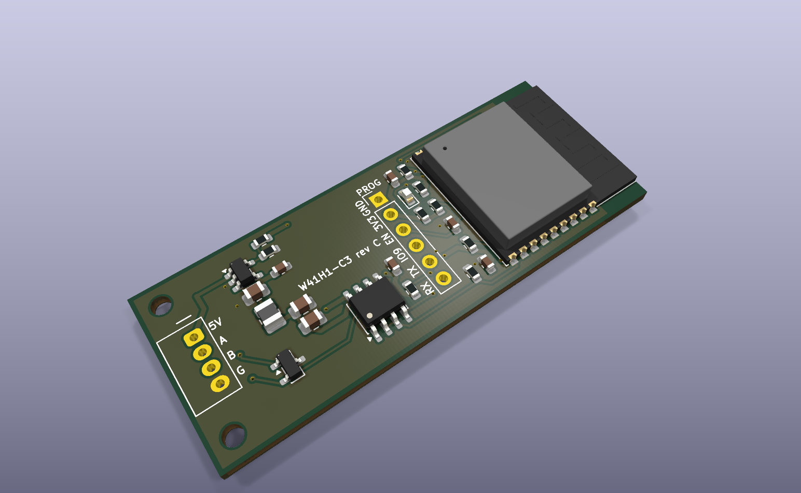
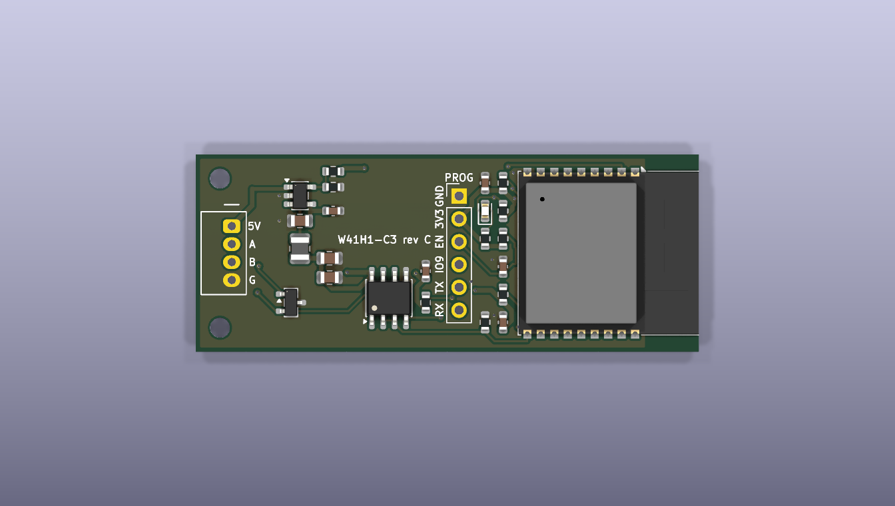
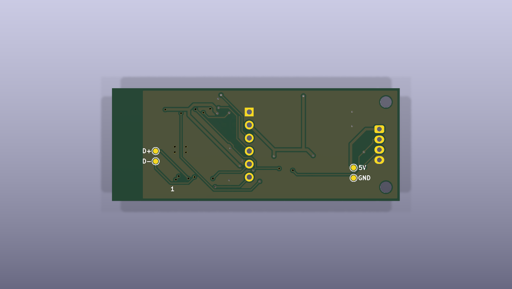

# Replacement module PCB

> **Rev C has not been fabricated.** Rev B was: five assembled boards from JLCPCB, ordered
> 2026-10-28, and one of them has run on an A/C unit since 2026-11-06 (bus link up, OTA works).
> Rev C is still a test board for the A/C units, not a fit for the stock module's bay: the bay's
> size is unmeasured, and the A/C header's dimensions are marked VERIFY below.

A test board for local control of the A/C: an ESP32-C3 module, a 3.3 V RS-485 transceiver and
the 4-pin A/C connector. It runs the same ESPHome firmware as the hand-wired ESP32-C3 build,
with the same pins, so `firmware/esphome/w41h1-esp32c3.yaml` applies unchanged. The matching
case is in [`../module-case`](../module-case).

## Rev C

Two things came out of putting a rev B board on a unit:

- No plug that fits the JST PH header matched the A/C's lead. The lead plugs into the stock
  module's own header, so rev C takes that header: `J1` is the 4-pin 2.0 mm side-entry
  header desoldered from the stock module (measured on 2026-11-06: 2.0 mm pitch, no plastic
  pegs), on a project footprint written by `scripts/place.py`. Its mating face sits on the board
  edge. How far the pin row sits behind that face (`J1_PIN_INSET`, 4.0 mm), the drill (0.9 mm)
  and the body size are placeholders marked `VERIFY` in `place.py` until they are measured on
  the stock module.
- The programming pads were awkward to use. `J2` is now a 2.54 mm pin header on the top side,
  so a standard jumper lead fits. The 1.27 mm pads on the bottom are gone, and the USB test pads
  stay.

Neither connector is assembled: both are marked not fitted, left out of the BOM and placement
files, and soldered in by hand. The board grew from 52 to 56 mm to make room for the header.
`place.py` also swaps the footprints on the board to match the schematic, so a footprint
change needs no step in the GUI.

Rev A was the size of the stock PCB (40 x 20.5 mm, estimated from the FCC photos) with parts on
both sides. Rev B traded the stock size for a lower assembly price: every assembled part is on
the top side.





## What is on it

| Block | Part | Notes |
|---|---|---|
| MCU | ESP32-C3-WROOM-02 | PCB antenna at the end away from the connector, over bare board |
| Supply | TLV62569DBV buck, 2.2 uH, 5 V to 3.3 V | the A/C port is rated 5 V at 450 mA, and a buck draws less from it than a linear regulator during Wi-Fi bursts |
| Bus | SP3485EN, SM712 TVS on A and B | DE and RE tied to one GPIO, 10 k pulldown on DE, 10 k pullup on RO |
| A/C port | 4-pin, 2.0 mm, side entry (`J1`) | the stock module's own header, desoldered and soldered in by hand; not assembled |
| Status LED | 0603 on GPIO8, lights when the pin is low | same as the SuperMini's LED |
| Programming | `J2` 2.54 mm pin header on top (GND, 3V3, EN, IO9, TX, RX, pin 1 at the board edge) and USB D-, D+, 5 V, GND test pads on the bottom | the header is not assembled |

## Pins

| Signal | GPIO | Goes to |
|---|---|---|
| Bus TX | 5 | transceiver DI |
| Bus RX | 6 | transceiver RO |
| Bus DE | 10 | transceiver DE and RE |
| Status LED | 8 | LED cathode |
| Boot | 9 | `J2` pin 4, 10 k pullup |
| UART0 TX, RX | 21, 20 | `J2` pins 5 and 6 |
| USB D-, D+ | 18, 19 | `TP1`, `TP2` |

`J1` follows the pinout in [Hardware and Wiring](../../docs/guide/Hardware-and-Wiring.md): pin 1 is
5 V, pins 2 and 3 are the RS-485 pair, pin 4 is ground. A and B are interchangeable on this bus:
if the link does not come up, swap them in the lead.

## Dimensions

| Dimension | Value |
|---|---|
| Board | 56 x 22 mm, 2 layers, 1.6 mm |
| Mounting holes | two, 2.2 mm (M2), 2.7 mm in from the connector end and from each long edge |
| A/C header `J1` | 4-pin, 2.0 mm pitch (measured on the stock module), mating face on the board edge, pin row 4.0 mm behind it, 0.9 mm drills. Inset, drill and body size are VERIFY |
| Programming header `J2` | 1x6, 2.54 mm, top side, 0.9 mm drills |
| Smallest drill | 0.3 mm |

All of them are constants at the top of `scripts/place.py`. Change the numbers and run it again:
it writes the A/C header footprint, puts the footprints the schematic names on the board,
places every footprint, redraws the outline and the keepouts and refills the ground pours. Run
it with `--unroute` when a change moves parts, then route again.

`place.py` also edits the module footprint: of its 13 thermal vias of 0.2 mm, four become
0.3 mm and the rest plain copper, because anything under 0.3 mm costs extra at JLCPCB. KiCad
reports that change as one "footprint differs from library" warning.

## Ordering at JLCPCB

`bash scripts/fab.sh`, then on JLCPCB's quote page: upload the gerber zip, keep the minimum via
hole at 0.3 mm and the 4-wire Kelvin test off, turn on assembly as Economic, top side, then upload
`fab/w41h1-module-bom.csv` and `fab/w41h1-module-cpl.csv`. All 15 BOM lines match JLCPCB's
library. `J1` and `J2` are in neither file: solder them in yourself.

The quote on 2026-10-14 for five assembled rev B boards was EUR 51.99 before shipping:

| Item | EUR |
|---|---|
| Bare boards | 3.57 |
| Assembly setup and stencil | 8.72 |
| Parts | 20.82 |
| Extended parts fee (six parts outside JLCPCB's basic library) | 13.77 |
| Machine and hand assembly, nitrogen reflow | 5.11 |

Shipping by DHL was about EUR 21 more. Prices change, so quote again before ordering. Rev C
already leaves the connectors off the order; swapping the diode, the inductor and the 453 k
resistor for basic library parts would cut it further.

## Files

- `w41h1-module.kicad_pro`, `.kicad_sch`, `.kicad_pcb`: the KiCad 10 project.
- `fp-lib-table`, `w41h1.pretty/`: the project footprint library, holding the A/C header
  footprint that `place.py` writes.
- `bom.csv`: the bill of materials with manufacturer and LCSC part numbers.
- `scripts/place.py`: the A/C header footprint, footprint swaps, placement, outline, keepouts,
  silkscreen labels, ground pours and the pre-routed connections, all derived from the
  dimensions above.
- `scripts/route.py`: runs Freerouting on the board and cleans up after it (track widths,
  stray vias, pour refill).
- `scripts/stitch.py`: joins the ground pour islands with vias after routing.
- `scripts/fab.sh`: runs ERC and DRC, then writes the fabrication files into `fab/`.
- `scripts/jlc_cpl.py`: turns KiCad's placement file into JLCPCB's column names.

## Fabrication files

```bash
bash scripts/fab.sh
```

It stops if ERC or DRC reports an error. Otherwise `fab/` (not tracked in git) holds:

| File | For |
|---|---|
| `w41h1-module-gerbers.zip` | the board order: two layers, 1.6 mm |
| `w41h1-module-bom.csv`, `w41h1-module-cpl.csv` | assembly: parts and placement, top side, without the two connectors |
| `w41h1-module-schematic.pdf` | reading the circuit without KiCad |
| `w41h1-module.step` | the 3D model the case is checked against |

## Regenerating the layout

```bash
python3 scripts/place.py --unroute     # footprint, swaps, place, pre-route, pour
python3 scripts/route.py               # Freerouting (jar path in FREEROUTING_JAR), then cleanup
python3 scripts/stitch.py              # join the ground islands
bash scripts/fab.sh
```

The regulator's connections, the module's supply link and three boxed-in ground pads are
pre-routed by `place.py`. The autorouter does the rest, and it gives a different result on
every run, so check that DRC reports no unconnected items each time. `route.py` prints its own
count after the import; the pour islands it includes are what `stitch.py` joins. Freerouting
2.5 does not count the pre-routed connections as routed and logs them as "unrouted" at the end:
that is expected. Nothing is routed by hand.

## What was checked

- ERC: no violations.
- DRC with schematic parity: no errors and no unconnected items. Two warnings remain, the
  module's antenna outline on the silkscreen crossing the board edge, plus the field notes
  below.
- The BOM has 15 lines and the placement file 23 parts, none of them `J1` or `J2`.
- The case ([`../module-case`](../module-case)) against the board's STEP: no overlap. The STEP
  leaves out the two not-fitted connectors, so that check does not see them.
- Pinouts and external parts against the manufacturers' datasheets, for the TLV62569DBV
  (pin order, 0.6 V feedback reference, 10 to 47 uF output capacitance), the
  ESP32-C3-WROOM-02 (pin table, pullups on GPIO2, GPIO8 and GPIO9, 10 k and 1 uF on EN,
  0.5 A supply) and the SP3485 (pin order, 3.3 V supply). The divider of 453 k over 100 k
  gives 3.32 V.
- The SM712 against its datasheet: pins 1 and 2 are the two lines, pin 3 is ground, and it
  clamps the +12 V to -7 V range RS-485 uses.
- The inductor (`L1`, FTC252012S2R2MGCA) against the maker's catalogue: 2.2 uH, 65 mOhm
  maximum, 2.7 A heating current and 3.3 A saturation current at worst, well above what this
  board draws.
- SPICE runs of the feedback divider, the EN delay and the decoupling networks pass.
- The gerbers hold every layer and both drill files.

## Before ordering

- Check the placement preview on JLCPCB's order page, part by part: it stayed blank in the
  browser used for the quote above, so part orientations have not been checked there. The
  placement file passes KiCad's rotations through unchanged.
- Measure the stock header before ordering: the distance from its mating face to the pin row
  (`J1_PIN_INSET`), its pin size (`J1_DRILL`) and its body (`J1_BODY`) are placeholders in
  `scripts/place.py`. Also confirm that its pin 1 is 5 V.
- Apart from the pre-routed parts, the routing came from an autorouter (Freerouting 2.5.0)
  with the cleanup in `route.py` and nothing by hand. The tracks under the module on the
  bottom side are longer than a hand layout would make them, which is harmless at 9600 baud.
- `J1` and `J2` are marked as not fitted. Solder them in yourself.
- Schematic parity lists 30 notes about fields (part number, description) that the footprints
  on the board do not carry. "Update PCB from Schematic" in KiCad copies them over.

## First power-up

Follow the staged bring-up in the
[ESP32 replacement guide](../../docs/guide/ESP32-Replacement-Build.md): flash and test on the
bench first, then connect only A and B to the unit, and power the board from the A/C port
last. Erase the module's flash before the first flash. The `PROG` header is labelled on the
top: hold IO9 low while EN rises to enter the bootloader over UART0, or use the USB pads on
the bottom.
