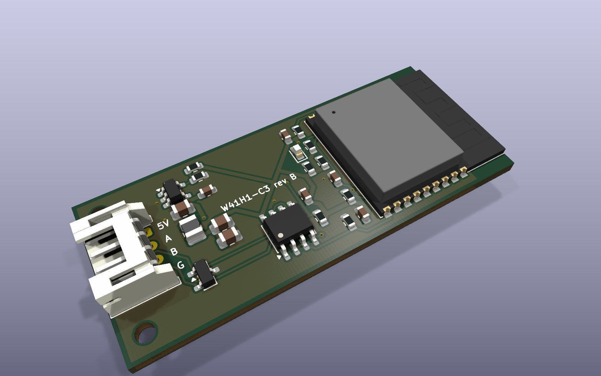

# Replacement module PCB

> **Rev B has not been fabricated and has not run on a unit.** It is a test board for the A/C
> units, not a fit for the stock module's bay: the bay's size and the A/C connector's type are
> still unmeasured.

A test board for local control of the A/C: an ESP32-C3 module, a 3.3 V RS-485 transceiver and
the 4-pin A/C connector. It runs the same ESPHome firmware as the hand-wired ESP32-C3 build,
with the same pins, so `firmware/esphome/w41h1-esp32c3.yaml` applies unchanged. The matching
case is in [`../module-case`](../module-case).

Rev A was the size of the stock PCB (40 x 20.5 mm, estimated from the FCC photos) with parts on
both sides. Rev B trades the stock size for a lower assembly price: every assembled part is on
the top side and the board is 52 x 22 mm.




## What is on it

| Block | Part | Notes |
|---|---|---|
| MCU | ESP32-C3-WROOM-02 | PCB antenna at the end away from the connector, over bare board |
| Supply | TLV62569DBV buck, 2.2 uH, 5 V to 3.3 V | the A/C port is rated 5 V at 450 mA, and a buck draws less from it than a linear regulator during Wi-Fi bursts |
| Bus | SP3485EN, SM712 TVS on A and B | DE and RE tied to one GPIO, 10 k pulldown on DE, 10 k pullup on RO |
| A/C port | 4-pin, 2.0 mm, side entry (`J1`) | footprint is JST PH `S4B-PH-K`. The series of the stock connector is not confirmed |
| Status LED | 0603 on GPIO8, lights when the pin is low | same as the SuperMini's LED |
| Programming | `J2` pads (GND, 3V3, EN, IO9, TX, RX) and USB D-, D+, 5 V, GND test pads | bare pads on the bottom side, nothing to assemble there |

## Pins

| Signal | GPIO | Goes to |
|---|---|---|
| Bus TX | 5 | transceiver DI |
| Bus RX | 6 | transceiver RO |
| Bus DE | 10 | transceiver DE and RE |
| Status LED | 8 | LED cathode |
| Boot | 9 | `J2` pin 4, 10 k pullup |
| UART0 TX, RX | 21, 20 | `J2` pins 5 and 6 |
| USB D-, D+ | 18, 19 | `TP1`, `TP2` |

`J1` follows the pinout in [Hardware and Wiring](../../docs/guide/Hardware-and-Wiring.md): pin 1 is
5 V, pins 2 and 3 are the RS-485 pair, pin 4 is ground. A and B are interchangeable on this bus:
if the link does not come up, swap them in the lead.

## Dimensions

| Dimension | Value |
|---|---|
| Board | 52 x 22 mm, 2 layers, 1.6 mm |
| Mounting holes | two, 2.2 mm (M2), 2.7 mm in from the connector end and from each long edge |
| A/C connector | 4-pin, 2.0 mm pitch. The stock connector measures about 2.0 mm in the FCC photo; its series is not confirmed |
| Smallest drill | 0.3 mm |

All of them are constants at the top of `scripts/place.py`. Change the numbers and run it again:
it places every footprint, redraws the outline and the keepouts and refills the ground pours.
Run it with `--unroute` when a change moves parts, then route again.

`place.py` also edits the module footprint: of its 13 thermal vias of 0.2 mm, four become
0.3 mm and the rest plain copper, because anything under 0.3 mm costs extra at JLCPCB. KiCad
reports that change as one "footprint differs from library" warning.

## Ordering at JLCPCB

`bash scripts/fab.sh`, then on JLCPCB's quote page: upload the gerber zip, keep the minimum via
hole at 0.3 mm and the 4-wire Kelvin test off, turn on assembly as Economic, top side, then upload
`fab/w41h1-module-bom.csv` and `fab/w41h1-module-cpl.csv`. All 16 BOM lines match JLCPCB's
library.

The quote on 2026-10-14 for five assembled boards was EUR 51.99 before shipping:

| Item | EUR |
|---|---|
| Bare boards | 3.57 |
| Assembly setup and stencil | 8.72 |
| Parts | 20.82 |
| Extended parts fee (six parts outside JLCPCB's basic library) | 13.77 |
| Machine and hand assembly, nitrogen reflow | 5.11 |

Shipping by DHL was about EUR 21 more. Prices change, so quote again before ordering. Two ways
to cut it further: swap the diode, the inductor and the 453 k resistor for basic library parts,
and leave the through-hole connector off the order and solder it yourself.

## Files

- `w41h1-module.kicad_pro`, `.kicad_sch`, `.kicad_pcb`: the KiCad 10 project.
- `bom.csv`: the bill of materials with manufacturer and LCSC part numbers.
- `scripts/place.py`: placement, outline, keepouts, silkscreen labels, ground pours and the
  pre-routed connections, all derived from the dimensions above.
- `scripts/stitch.py`: joins the ground pour islands with vias after routing.
- `scripts/fab.sh`: runs ERC and DRC, then writes the fabrication files into `fab/`.
- `scripts/jlc_cpl.py`: turns KiCad's placement file into JLCPCB's column names.

## Fabrication files

```bash
bash scripts/fab.sh
```

It stops if ERC or DRC reports an error. Otherwise `fab/` (not tracked in git) holds:

| File | For |
|---|---|
| `w41h1-module-gerbers.zip` | the board order: two layers, 1.6 mm |
| `w41h1-module-bom.csv`, `w41h1-module-cpl.csv` | assembly: parts and placement, both sides |
| `w41h1-module-schematic.pdf` | reading the circuit without KiCad |
| `w41h1-module.step` | the 3D model the case is checked against |

## Regenerating the layout

```bash
python3 scripts/place.py --unroute     # place, pre-route, pour
# route the rest: Freerouting on the board's Specctra export, or by hand in KiCad
python3 scripts/stitch.py              # join the ground islands
bash scripts/fab.sh
```

The regulator's connections, the module's supply link and its ground pin are pre-routed by
`place.py`. The autorouter does the rest, and it gives a different result on every run, so
check that DRC reports no unconnected items each time.

## What was checked

- ERC: no violations.
- DRC: no errors and no unconnected items. Three warnings remain: the module's antenna
  outline on the silkscreen crossing the board edge (two), and the edited module footprint.
- Pinouts and external parts against the manufacturers' datasheets, for the TLV62569DBV
  (pin order, 0.6 V feedback reference, 10 to 47 uF output capacitance), the
  ESP32-C3-WROOM-02 (pin table, pullups on GPIO2, GPIO8 and GPIO9, 10 k and 1 uF on EN,
  0.5 A supply) and the SP3485 (pin order, 3.3 V supply). The divider of 453 k over 100 k
  gives 3.32 V.
- The SM712 against its datasheet: pins 1 and 2 are the two lines, pin 3 is ground, and it
  clamps the +12 V to -7 V range RS-485 uses.
- The inductor (`L1`, FTC252012S2R2MGCA) against the maker's catalogue: 2.2 uH, 65 mOhm
  maximum, 2.7 A heating current and 3.3 A saturation current at worst, well above what this
  board draws.
- SPICE runs of the feedback divider, the EN delay and the decoupling networks pass.
- The gerbers hold every layer and both drill files.

## Before ordering

- Check the placement preview on JLCPCB's order page, part by part: it stayed blank in the
  browser used for the quote above, so part orientations have not been checked there. The
  placement file passes KiCad's rotations through unchanged.
- Confirm that the stock lead's plug fits a JST PH header and that its pin 1 is 5 V. If the
  plug is another 2.0 mm series, change `J1`.
- Apart from the pre-routed parts, the routing came from an autorouter (Freerouting 2.1.0)
  with no manual cleanup. The tracks under the module on the bottom side are longer than a
  hand layout would make them, which is harmless at 9600 baud.
- `J2` is a row of pads for programming and is marked as not fitted.
- Schematic parity lists 31 notes about fields (part number, description) that the footprints
  on the board do not carry. "Update PCB from Schematic" in KiCad copies them over.

## First power-up

Follow the staged bring-up in the
[ESP32 replacement guide](../../docs/guide/ESP32-Replacement-Build.md): flash and test on the
bench first, then connect only A and B to the unit, and power the board from the A/C port
last. Erase the module's flash before the first flash. The `PROG` pads are labelled on the
bottom: hold IO9 low while EN rises to enter the bootloader over UART0, or use the USB pads.
