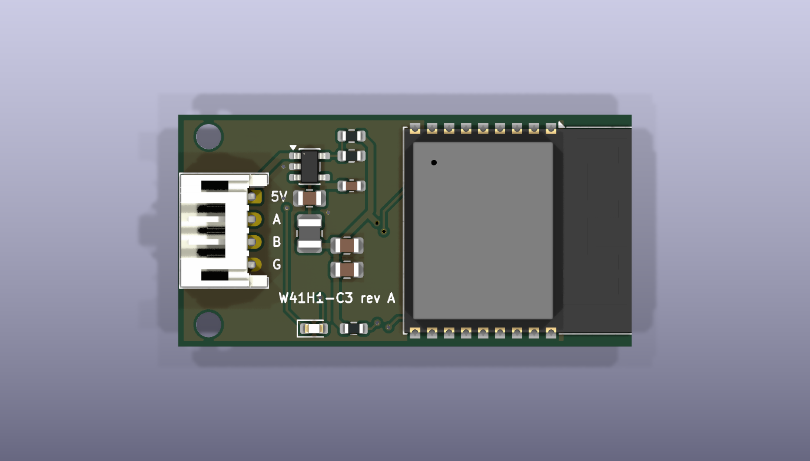
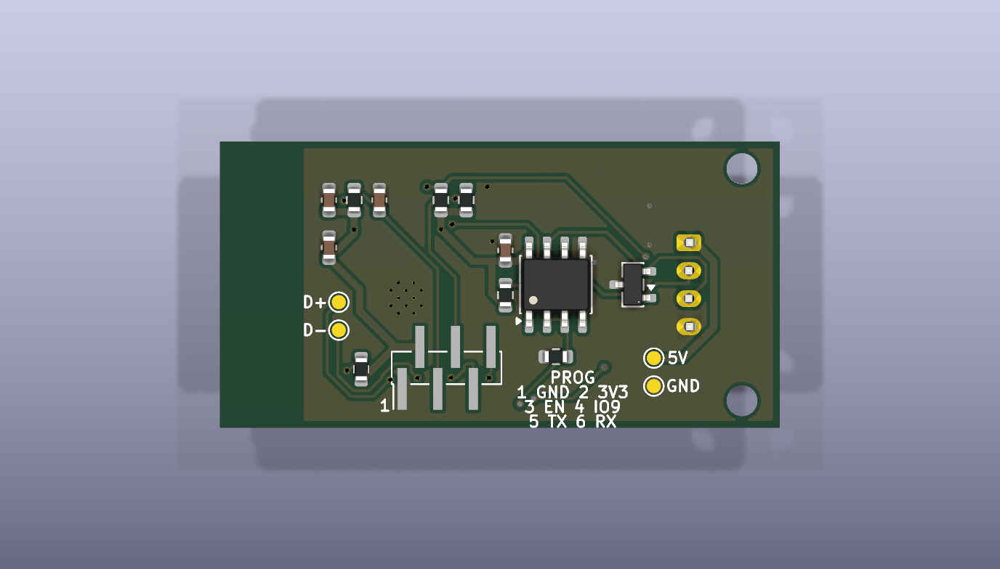

# Replacement module PCB

> **This board has not been fabricated and has not run on a unit.** The outline, the mounting
> holes and the connector pitch are estimates scaled off the internal photo in the FCC filing
> (FCC ID 2AGCCAEH-W41H1). Nobody has measured a module with calipers yet: do that before ordering.

A carrier board for the bay the stock `AEH-W41H1` module sits in: an ESP32-C3 module, a 3.3 V
RS-485 transceiver and the 4-pin A/C connector on one board the size of the stock PCB. It runs
the same ESPHome firmware as the hand-wired ESP32-C3 build, with the same pins, so
`firmware/esphome/w41h1-esp32c3.yaml` applies unchanged. The matching case is in
[`../module-case`](../module-case).




## What is on it

| Block | Part | Notes |
|---|---|---|
| MCU | ESP32-C3-WROOM-02 | PCB antenna at the end away from the connector, as on the stock board |
| Supply | TLV62569DBV buck, 2.2 uH, 5 V to 3.3 V | the A/C port is rated 5 V at 450 mA, and a buck draws less from it than a linear regulator during Wi-Fi bursts |
| Bus | SP3485EN, SM712 TVS on A and B | DE and RE tied to one GPIO, 10 k pulldown on DE, 10 k pullup on RO |
| A/C port | 4-pin, 2.0 mm, side entry (`J1`) | footprint is JST PH `S4B-PH-K`. The series of the stock connector is not confirmed |
| Status LED | 0603 on GPIO8, lights when the pin is low | same as the SuperMini's LED |
| Programming | `J2` pads (GND, 3V3, EN, IO9, TX, RX) and USB D-, D+, 5 V, GND test pads | on the bottom side, not fitted with a header |

## Pins

| Signal | GPIO | Goes to |
|---|---|---|
| Bus TX | 5 | transceiver DI |
| Bus RX | 6 | transceiver RO |
| Bus DE | 10 | transceiver DE and RE |
| Status LED | 8 | LED cathode |
| Boot | 9 | `J2` pin 4, 10 k pullup |
| UART0 TX, RX | 21, 20 | `J2` pins 5 and 6 |
| USB D-, D+ | 18, 19 | `TP1`, `TP2` |

`J1` follows the pinout in [Hardware and Wiring](../../docs/guide/Hardware-and-Wiring.md): pin 1 is
5 V, pins 2 and 3 are the RS-485 pair, pin 4 is ground. A and B are interchangeable on this bus:
if the link does not come up, swap them in the lead.

## Dimensions that are estimates

| Dimension | Value used | Source |
|---|---|---|
| Board | 40.0 x 20.5 mm | photo, scaled with the SOIC-8 pin pitch as the ruler, about 3 % error |
| Mounting holes | two, 2.2 mm, 16.6 mm apart, 2.7 mm from the connector edge | photo |
| Connector pitch | 2.0 mm | photo (measures about 2.1 mm) |
| Board thickness | 1.6 mm | not measured |

All of them are constants at the top of `scripts/place.py`. Change the numbers and run it again:
it places every footprint, redraws the outline and the keepouts and refills the ground pours.
Run it with `--unroute` when a change moves parts, then route again.

The module is 18 mm wide. On a board narrower than about 20 mm its pads come closer to the
edge than the 0.5 mm the design rules allow, and the board needs a smaller module.

## Files

- `w41h1-module.kicad_pro`, `.kicad_sch`, `.kicad_pcb`: the KiCad 10 project.
- `bom.csv`: the bill of materials with manufacturer and LCSC part numbers.
- `scripts/place.py`: placement, outline, keepouts, silkscreen labels, ground pours and the
  pre-routed connections, all derived from the dimensions above.
- `scripts/stitch.py`: joins the ground pour islands with vias after routing.
- `scripts/fab.sh`: runs ERC and DRC, then writes the fabrication files into `fab/`.
- `scripts/jlc_cpl.py`: turns KiCad's placement file into JLCPCB's column names.

## Fabrication files

```bash
bash scripts/fab.sh
```

It stops if ERC or DRC reports an error. Otherwise `fab/` (not tracked in git) holds:

| File | For |
|---|---|
| `w41h1-module-gerbers.zip` | the board order: two layers, 1.6 mm |
| `w41h1-module-bom.csv`, `w41h1-module-cpl.csv` | assembly: parts and placement, both sides |
| `w41h1-module-schematic.pdf` | reading the circuit without KiCad |
| `w41h1-module.step` | the 3D model the case is checked against |

## Regenerating the layout

```bash
python3 scripts/place.py --unroute     # place, pre-route, pour
# route the rest: Freerouting on the board's Specctra export, or by hand in KiCad
python3 scripts/stitch.py              # join the ground islands
bash scripts/fab.sh
```

The regulator's connections, the module's supply link and its ground pin are pre-routed by
`place.py`. The autorouter does the rest, and it gives a different result on every run, so
check that DRC reports no unconnected items each time.

## What was checked

- ERC: no violations.
- DRC: no errors and no unconnected items. Two warnings remain, both the module's antenna
  outline on the silkscreen crossing the board edge.
- Pinouts and external parts against the manufacturers' datasheets, for the TLV62569DBV
  (pin order, 0.6 V feedback reference, 10 to 47 uF output capacitance), the
  ESP32-C3-WROOM-02 (pin table, pullups on GPIO2, GPIO8 and GPIO9, 10 k and 1 uF on EN,
  0.5 A supply) and the SP3485 (pin order, 3.3 V supply). The divider of 453 k over 100 k
  gives 3.32 V.
- The SM712's pin order was not checked against its datasheet (the download failed). It
  follows KiCad's library symbol and the usual SOT-23 arrangement for that part.
- SPICE runs of the feedback divider, the EN delay and the decoupling networks pass.
- The gerbers hold every layer and both drill files.

## Before ordering

- Measure a real module and update the estimates in `scripts/place.py`.
- Confirm that the stock lead's plug fits a JST PH header and that its pin 1 is 5 V. If the
  plug is another 2.0 mm series, change `J1`.
- The module footprint has 0.2 mm thermal vias under its ground pad, and the project's minimum
  drill is set to 0.2 mm to allow them. That is below the standard 0.3 mm minimum of the cheap
  fabrication tiers: either pay for the smaller drill or edit the footprint.
- Apart from the pre-routed parts, the routing came from an autorouter (Freerouting 2.1.0)
  with no manual cleanup. The tracks under the module on the bottom side are longer than a
  hand layout would make them, which is harmless at 9600 baud.
- The inductor (`L1`, FTC252012S2R2MGCA) was picked by value and size. Its saturation current
  was not checked against a datasheet: the regulator needs at least 1 A here.
- Check each part's rotation in the assembly house's placement preview. The placement file
  passes KiCad's rotations through unchanged.
- `J2` is a row of pads for programming and is marked as not fitted.
- Schematic parity lists 31 notes about fields (part number, description) that the footprints
  on the board do not carry. "Update PCB from Schematic" in KiCad copies them over.

## First power-up

Follow the staged bring-up in the
[ESP32 replacement guide](../../docs/guide/ESP32-Replacement-Build.md): flash and test on the
bench first, then connect only A and B to the unit, and power the board from the A/C port
last. Erase the module's flash before the first flash. The `PROG` pads are labelled on the
bottom: hold IO9 low while EN rises to enter the bootloader over UART0, or use the USB pads.
